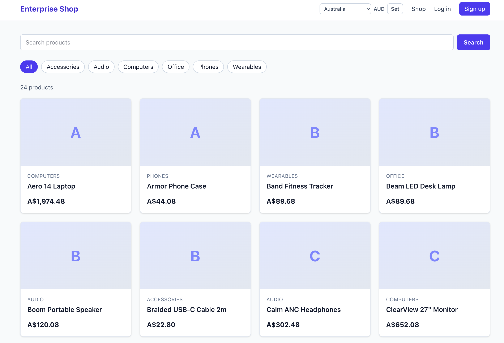
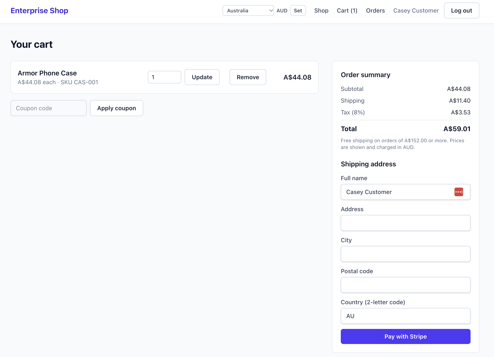
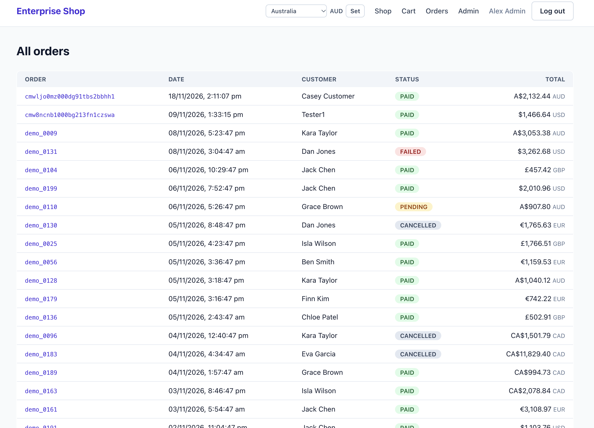
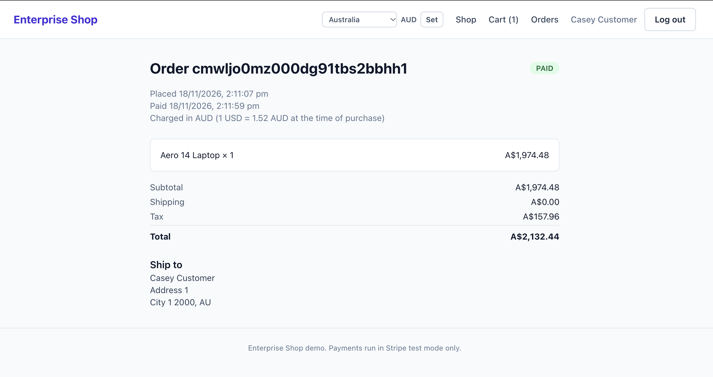

# Enterprise Shop

[](https://github.com/gmaroli/enterprise-shop/actions/workflows/ci.yml) [](https://buildkite.com/enterprise-shop/enterprise-shop)

A demo e-commerce system built as a realistic target for learning and practising software testing and quality engineering. It has a storefront, an admin area, a REST API, a PostgreSQL database, Stripe test-mode payments, multi-currency pricing, and a separate analytics data warehouse with an ETL job.

It is a **local demo**: nothing here is meant to be deployed as-is, and it only ever uses Stripe **test** keys.

## What it does

**For shoppers**

- Browse and search a product catalog (categories, paging).
- Register, log in, and keep a cart that persists between sessions.
- Apply coupons, check out with a shipping address, and pay on Stripe's hosted page.
- Prices, shipping and totals are shown and charged in the shopper's currency (USD, AUD, GBP, CAD or EUR), chosen from the country detected from their IP address or picked in the header.
- View order history and order details.

**For admins**

- Create, edit and deactivate products.
- View all orders.
- Edit the demo exchange rates.

**Behind the scenes**

- A REST API with JWT login, roles, input validation and Swagger documentation.
- Order completion driven by Stripe webhooks, with a fallback that re-checks a payment with Stripe if the webhook was missed.
- An analytics warehouse (staging, star schema, reporting views) loaded incrementally from the app database.

## Screenshots

Prices are shown here in Australian dollars because the demo was run with Australia selected.

**Storefront**



**Cart, with checkout in a non-USD currency**



**Admin: all orders**



**Order details**



## Architecture

```
Browser ──> apps/web (Next.js) ──server-side calls──> apps/api (NestJS) ──> PostgreSQL (database "shop")
                                                          │
                                                          └──> Stripe Checkout (test mode)
Stripe ──webhook──> apps/api

apps/etl (Python) ──reads──> "shop" database ──loads──> PostgreSQL (database "warehouse")
```

| Part                                                            | Path              | Default address         |
| --------------------------------------------------------------- | ----------------- | ----------------------- |
| Storefront and admin (Next.js 15, React 19, Tailwind 4)         | `apps/web`        | http://localhost:3001   |
| REST API (NestJS 11, Swagger at `/api/docs`)                    | `apps/api`        | http://localhost:4000   |
| Warehouse loader (Python, psycopg, SQL files)                   | `apps/etl`        | database `warehouse`    |
| Database schema, migrations and seed data (Prisma 6)            | `packages/db`     | PostgreSQL on port 5432 |
| Shared pricing, currency, permission and validation logic (zod) | `packages/shared` |                         |
| Shared TypeScript configuration                                 | `packages/config` |                         |
| Docker Compose for PostgreSQL                                   | `infra/`          |                         |
| Requirements, architecture, API and warehouse docs              | `docs/`           |                         |

The repository is a pnpm workspace orchestrated by Turborepo.

## Prerequisites

- **Node.js 22 or newer**
- **pnpm 12** (see https://pnpm.io/installation)
- **Docker Desktop** (runs PostgreSQL)
- **uv** (Python tooling for `apps/etl`; see https://docs.astral.sh/uv/)
- A free **Stripe account** in test mode, only needed to try payments

**Operating system:** developed and run on macOS. Linux should work the same way. On Windows, use [WSL2](https://learn.microsoft.com/windows/wsl/install) (Windows Subsystem for Linux) and run every command in this README inside it, because the setup uses Unix commands such as `cp`, `mkdir -p` and `sh` (for example in `pnpm stripe:listen`).

## Getting started

```bash
git clone https://github.com/gmaroli/enterprise-shop.git
cd enterprise-shop

pnpm install
cp .env.example .env      # then edit .env (see "Configuration")
pnpm db:up                # start PostgreSQL in Docker
docker ps                 # wait until shop-postgres says "(healthy)"
pnpm db:migrate           # create the database tables
pnpm db:seed              # base data: products, two accounts, exchange rates
pnpm db:seed:demo         # optional: ~220 demo orders and 12 demo customers
pnpm warehouse:init       # optional: create the analytics warehouse
pnpm dev                  # web on :3001, API on :4000
```

**How to tell it worked**

- After `pnpm db:up`, run `docker ps`. The `shop-postgres` row should say `Up ... (healthy)`. If it says `(health: starting)`, wait a few seconds and run it again before migrating.
- After `pnpm dev`, wait until the terminal shows `API listening on http://localhost:4000/api` and the web app reports it is ready. Then check:
  - http://localhost:3001 shows the shop with a list of products.
  - http://localhost:4000/api/products returns product data as JSON.
  - http://localhost:4000/api/docs opens the interactive API documentation (Swagger).

Without Stripe keys everything works except paying.

> `pnpm db:seed` **deletes every user, order and product** before reloading the base data. Only use it on a database you are happy to reset.

**Demo accounts.** These exist only on your own machine, created by the seed scripts. They are fake logins for local practice; never reuse these passwords anywhere real.

| Account           | Email                                                      | Password       | Created by          |
| ----------------- | ---------------------------------------------------------- | -------------- | ------------------- |
| Admin             | `admin@shop.test`                                          | `Admin123!`    | `pnpm db:seed`      |
| Customer          | `customer@shop.test`                                       | `Customer123!` | `pnpm db:seed`      |
| 12 demo customers | `demo.customer01@shop.test` to `demo.customer12@shop.test` | `Customer123!` | `pnpm db:seed:demo` |

You can also register new accounts at `/register`. The passwords are defined in `packages/db/prisma/seed.ts` and `seed-demo.ts`.

## What runs in Docker

Only the database runs in Docker. `infra/docker-compose.yml` defines a single service:

- **PostgreSQL 17** in a container named `shop-postgres`, published on port 5432. One server holds two databases: `shop` (the app) and `warehouse` (analytics, created by `pnpm warehouse:init`).
- Data lives in a Docker **volume** named `shop-pgdata`, so it survives restarts and `pnpm db:down`. Removing the volume (for example `docker compose -f infra/docker-compose.yml down -v`) deletes all data.
- A healthcheck marks the container `(healthy)` once Postgres accepts connections, and the container restarts automatically unless you stop it.

The web app, the API and the ETL job are **not** in containers. They run directly on your machine through `pnpm dev` and the `warehouse:*` scripts. The database login in the compose file is a throwaway local password, not a real credential.

## Configuration

All settings live in one `.env` file at the repository root, shared by the API, the web app, Prisma and the ETL job. `.env` is git-ignored; **never commit it**. `.env.example` lists every variable with safe local defaults.

| Variable                | Purpose                                                                                     |
| ----------------------- | ------------------------------------------------------------------------------------------- |
| `DATABASE_URL`          | Connection string for the app database                                                      |
| `WAREHOUSE_URL`         | Connection string for the analytics warehouse database                                      |
| `API_PORT`, `API_URL`   | Port the API listens on and the address the web app uses to reach it                        |
| `WEB_URL`               | Public address of the web app (used for Stripe redirect URLs and CORS)                      |
| `JWT_SECRET`            | Secret used to sign login tokens. **Set your own**, for example with `openssl rand -hex 32` |
| `JWT_EXPIRES_IN`        | Login token lifetime (default `7d`)                                                         |
| `STRIPE_SECRET_KEY`     | Your Stripe **test** secret key (starts with `sk_test_`)                                    |
| `STRIPE_WEBHOOK_SECRET` | Webhook signing secret printed by `pnpm stripe:listen`                                      |
| `GEO_DEV_IP`            | Stand-in IP address used for country detection on localhost                                 |
| `GEO_DEFAULT_COUNTRY`   | Country used when nothing can be detected                                                   |

If you change the web port, update `WEB_URL` and the port in `apps/web/package.json` to match. The API only reads `.env` when it starts, so restart it after changes.

## Stripe test payments

The shop pays through Stripe Checkout in **test mode**: Stripe's real hosted payment page, but with fake money. Setting it up takes a few minutes and is free. Stripe's dashboard menus change from time to time, so if a name below does not match, use the dashboard search or see https://docs.stripe.com/testing.

### 1. Create a Stripe account

1. Sign up at https://dashboard.stripe.com/register with an email address and password, and confirm your email if asked.
2. If Stripe asks for a business name or other business details, enter anything (for example "Enterprise Shop Demo") or skip the step. Activating the account is only needed to take real payments and is **not** needed for test mode.

### 2. Switch to test mode

Make sure the dashboard is in **test mode** (Stripe may call it a _sandbox_); there is a toggle or banner near the top of the dashboard. Everything you create there uses fake money, and test keys start with `sk_test_`. If a key starts with `sk_live_`, you are in live mode: stop and switch back.

### 3. Copy your test secret key

1. In the dashboard open **Developers > API keys**.
2. Reveal and copy the **Secret key** (`sk_test_...`). This project does not need the publishable key.
3. Paste it into your `.env` file:
   ```
   STRIPE_SECRET_KEY=<your sk_test_ key>
   ```
4. Keep the key private: `.env` is git-ignored, so do not commit it, paste it into chats or screenshots, or put it in code. If it is ever exposed, roll the key in the dashboard to replace it.

### 4. Forward webhooks to your machine

Stripe cannot reach `localhost`, so the Stripe CLI relays Stripe's events to your API. The CLI is a dev dependency of this repository (nothing is installed globally) and does not need `stripe login`; it reads the key from `.env`.

1. Make sure the app is running (`pnpm dev`).
2. In a **second terminal** at the repository root run:
   ```bash
   pnpm stripe:listen
   ```
3. It prints a line like `Your webhook signing secret is whsec_...`. Copy that value into `.env`:
   ```
   STRIPE_WEBHOOK_SECRET=<your whsec_ value>
   ```
4. Restart the API so it reads the new value, and **leave `pnpm stripe:listen` running** whenever you test payments.

### 5. Make a test payment

1. Open the storefront and log in with a customer account.
2. Add a product to the cart, fill in the shipping address and choose **Pay with Stripe**.
3. On Stripe's page use the test card `4242 4242 4242 4242` with any future expiry date, any 3-digit CVC and any postal code.
4. You are returned to the success page. The order should show **PAID**, the cart should be empty and stock should have gone down.

Other test cards, including declines and 3D Secure, are listed at https://docs.stripe.com/testing. For example, `4000 0000 0000 0002` is declined.

### 6. Check it in Stripe

With the dashboard in test mode, the payment appears under **Payments**, and the events that were sent (for example `checkout.session.completed`) appear under **Developers > Events**. The `pnpm stripe:listen` terminal also logs every event it forwards together with the API's response code (200 means your API accepted it).

### If something does not work

| Symptom                                         | Likely cause and fix                                                                                                                                                                                   |
| ----------------------------------------------- | ------------------------------------------------------------------------------------------------------------------------------------------------------------------------------------------------------ |
| "Stripe is not configured" when paying          | `STRIPE_SECRET_KEY` is missing or still the placeholder, or the API was not restarted after you set it.                                                                                                |
| `pnpm stripe:listen` reports an invalid API key | The key was copied incompletely, or it is a live key, or it belongs to a different account. Copy the test secret key again.                                                                            |
| Order stays **PENDING** after paying            | `pnpm stripe:listen` was not running, or `STRIPE_WEBHOOK_SECRET` does not match the one it printed. Use **Check payment status** on the order (or revisit the success page); both ask Stripe directly. |
| "Invalid Stripe signature" in the API log       | `STRIPE_WEBHOOK_SECRET` is wrong or from an older listener session. Copy the current value again and restart the API.                                                                                  |
| Payment declined                                | You used a decline test card, or the card number was mistyped. Use `4242 4242 4242 4242`.                                                                                                              |

Orders become **PAID** when Stripe's webhook arrives. Never use live keys with this project.

## Country and currency

- The web app detects the visitor's country from their IP using a bundled country database (public-domain data; no account and no network calls). A country chosen in the header overrides detection, and "Auto" returns to it.
- Supported currencies: USD (also the fallback), AUD, GBP, CAD and EUR.
- Product prices are stored in USD and converted with exchange rates kept in the database. Admins edit the demo rates at `/admin/rates`. Each order records the currency and rate it was charged at.
- On localhost your address is private and has no country, so `GEO_DEV_IP` stands in for it. Try `1.1.1.1` (Australia), `8.8.8.8` (United States) or `81.2.69.142` (United Kingdom).

## Business rules at a glance

- Coupons: `WELCOME10` takes 10% off the subtotal; `FREESHIP` removes shipping.
- Shipping: a flat fee of 7.50 USD, free for subtotals of 100 USD or more (converted to the shopper's currency).
- Tax: 8% of the discounted subtotal; shipping is not taxed.
- Stock is reduced when an order is paid, not when it is created.

Full details and acceptance criteria are in [docs/requirements.md](docs/requirements.md).

## Data warehouse

`apps/etl` copies orders, customers and products from the app database into a separate `warehouse` database with staging tables, a star schema (dimensions and facts), and reporting views. Amounts are available in the order currency and in USD.

```bash
pnpm warehouse:init     # once: create the database, tables, constraints and views
pnpm warehouse:run      # incremental load (changes since the last successful run)
pnpm warehouse:full     # reload everything
pnpm warehouse:status   # recent runs and row counts
```

The model, rules and limitations are described in [docs/warehouse.md](docs/warehouse.md); a data dictionary is available in the view `reporting.v_data_dictionary`.

## Scripts

| Command                       | What it does                                                                                |
| ----------------------------- | ------------------------------------------------------------------------------------------- |
| `pnpm dev`                    | Start the web app and API with live reload                                                  |
| `pnpm build`                  | Build everything                                                                            |
| `pnpm lint`, `pnpm typecheck` | Static checks                                                                               |
| `pnpm test`                   | Run the unit tests                                                                          |
| `pnpm format`                 | Format the code with Prettier                                                               |
| `pnpm format:check`           | Check formatting without changing files (what CI runs)                                      |
| `pnpm db:up`, `pnpm db:down`  | Start or stop PostgreSQL                                                                    |
| `pnpm db:migrate`             | Apply database migrations                                                                   |
| `pnpm db:seed`                | Reset to the base data (**destructive**)                                                    |
| `pnpm db:seed:demo`           | Add or regenerate the demo orders                                                           |
| `pnpm db:reset`               | Drop and recreate the database from migrations, then re-run the base seed (**destructive**) |
| `pnpm warehouse:*`            | Warehouse commands (see above)                                                              |
| `pnpm stripe:listen`          | Forward Stripe test webhooks to the API                                                     |

## Testing

`pnpm test` runs the developer unit tests (Vitest), which sit next to the code in `packages/shared`, `apps/api` and `apps/web`. They cover business rules such as pricing, currency conversion, validation, permissions and the Stripe payment decision logic. There are no integration, API, end-to-end, performance, security or data tests in this repository; the project is meant to be tested from outside.

Useful when planning tests:

- [docs/requirements.md](docs/requirements.md) describes intended behaviour.
- The API is documented interactively at http://localhost:4000/api/docs.
- The storefront has no dedicated test hooks (such as `data-testid`); use labels, roles and text.
- The web app reads the `x-forwarded-for` header for country detection, and the `shop_country` cookie pins a country.
- Payment happens on Stripe's hosted page, which is difficult to automate; many teams exercise it manually and test around it.

Continuous integration (CI) runs on Buildkite for pull requests and pushes. A GitHub Actions setup is kept but paused (it only runs when started by hand). Buildkite reports three checks, so a pull request shows three short lines:

| Check        | What it runs                                                                         |
| ------------ | ------------------------------------------------------------------------------------ |
| Code quality | ESLint, Ruff (ETL), Prettier (`pnpm format:check`) and `pnpm typecheck`, in one step |
| Build        | `pnpm build`                                                                         |
| Unit tests   | `pnpm test`                                                                          |

Code quality runs every check even if one fails, and lists which ones failed (in the log and as a build annotation).

- **GitHub Actions** (`.github/workflows/ci.yml`) is **paused**: it runs only when started by hand from the Actions tab. Shared setup lives in `.github/actions/setup`. See [docs/ci.md](docs/ci.md) for how to switch it back on.
- **Buildkite** (`.buildkite/pipeline.yml`) runs on Buildkite's hosted agents. To use it you need your own Buildkite account and a pipeline connected to the repository whose first step is `buildkite-agent pipeline upload`. Shared setup lives in `.buildkite/scripts/setup.sh` and the code quality step in `.buildkite/scripts/code-quality.sh`.

More detail, including how to require these checks before merging, is in [docs/ci.md](docs/ci.md).

## Troubleshooting

| Symptom                                                                   | Likely cause and fix                                                                                                                                                |
| ------------------------------------------------------------------------- | ------------------------------------------------------------------------------------------------------------------------------------------------------------------- |
| `pnpm install` stops with `ERR_PNPM_IGNORED_BUILDS`                       | A dependency has an install script pnpm has not been told about. Run `pnpm approve-builds` and decide per package; the choices are stored in `pnpm-workspace.yaml`. |
| `pnpm db:up` fails                                                        | Docker Desktop is not running.                                                                                                                                      |
| Port already in use                                                       | Another program uses 3001, 4000 or 5432. Stop it or change the port (and `WEB_URL` / `API_URL` to match).                                                           |
| Prices always show USD locally                                            | Set `GEO_DEV_IP` in `.env` and restart the API, or pick a country in the header.                                                                                    |
| Paid order stays `PENDING`                                                | `pnpm stripe:listen` was not running or `STRIPE_WEBHOOK_SECRET` is wrong. Use **Check payment status** on the order.                                                |
| "Stripe is not configured" when paying                                    | `STRIPE_SECRET_KEY` is missing or still a placeholder; restart the API after setting it.                                                                            |
| Web or API errors after running `pnpm build` while `pnpm dev` was running | Both write to the same output folders. Stop `pnpm dev` and start it again.                                                                                          |
| Environment changes have no effect                                        | Restart the API (and web app) so they re-read `.env`.                                                                                                               |

## Security notes

- This is a demo for local use. Seeded accounts, the database password in `infra/docker-compose.yml` and the default values in `.env.example` are placeholders; change them for anything beyond your own machine.
- Keep `.env` out of version control and use Stripe test keys only.
- The country database is built from regional registry data. It is country-level and not always accurate, and it is used only to pre-fill defaults.

## Conventions

- Money is stored as integer cents everywhere. Product prices are in USD; other currencies are derived with the exchange-rate table. Pricing and conversion rules live in `packages/shared`.
- Inputs are validated with the zod schemas in `packages/shared`.
- The web app calls the API only from the server, and the login token is kept in an httpOnly cookie.
- Small, focused commits, one feature slice at a time.

## More documentation

- [docs/requirements.md](docs/requirements.md): features, business rules and acceptance criteria
- [docs/architecture.md](docs/architecture.md): how the pieces fit together and the checkout flow
- [docs/api.md](docs/api.md): endpoint overview (full detail in Swagger)
- [docs/warehouse.md](docs/warehouse.md): warehouse model, rules and limitations
- [docs/ci.md](docs/ci.md): the CI checks and how to require them before merging

## License

Released under the [MIT License](LICENSE).
